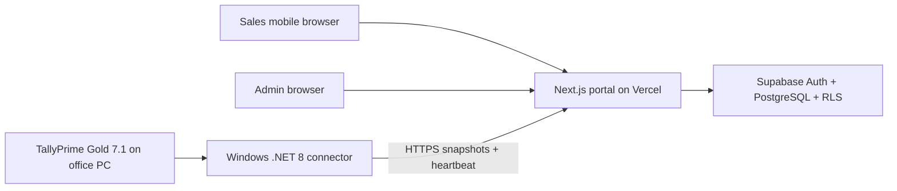

# IMPLY Stock Portal

Production-oriented inventory and custom-price portal for IMPLY sales executives. The portal is read-only: it shows stock, godown balances, custom selling prices, and sync freshness, but never creates orders, reserves stock, or modifies TallyPrime.

## Architecture



The repository is organized as:

- `portal`: Next.js App Router, TypeScript, Tailwind CSS, Supabase Auth, admin UI, and connector API.
- `connector`: .NET 8 Windows service and diagnostic console for TallyPrime read-only extraction.
- `supabase`: PostgreSQL migrations and development seed data.
- `docs`: deployment checklist and operating notes.

The original static prototype files remain at the repository root for reference.

## Local Setup

1. Install Node.js 22 LTS and .NET 8 SDK.
2. Install portal dependencies:

```powershell
npm install
```

3. Copy the environment template:

```powershell
Copy-Item portal\.env.example portal\.env.local
```

4. Start the portal:

```powershell
npm run dev
```

Without Supabase environment variables, the portal runs in development mode with clearly marked sample catalogue and inventory data.

## Supabase Setup

1. Create a Supabase project.
2. Open SQL Editor and run `supabase/migrations/001_initial_schema.sql`.
3. For local demonstration only, run `supabase/seed/development_seed.sql`.
4. Enable Supabase email/password authentication.
5. Create user accounts.
6. Bootstrap the first admin safely:

```sql
insert into public.profiles (id, full_name, role, active)
values ('AUTH_USER_UUID_FROM_SUPABASE', 'Initial Admin', 'admin', true)
on conflict (id) do update set role = 'admin', active = true;
```

After the first admin exists, manage additional roles through controlled admin SQL or a future user-management screen. Do not expose the service-role key to browser code.

## Portal Environment

Set these on Vercel and in `portal/.env.local` for local Supabase mode:

- `NEXT_PUBLIC_SUPABASE_URL`
- `NEXT_PUBLIC_SUPABASE_ANON_KEY`
- `SUPABASE_SERVICE_ROLE_KEY`
- `CONNECTOR_SECRET_HASH`
- `APP_URL`
- `DATA_FRESHNESS_MINUTES`
- `CONNECTOR_MAX_PAYLOAD_BYTES`

Generate a connector secret hash:

```powershell
node -e "const crypto=require('crypto'); console.log(crypto.createHash('sha256').update(process.argv[1]).digest('base64url'))" "choose-a-long-secret"
```

## Vercel Deployment

1. Import this repository in Vercel.
2. Set the project root to `portal`.
3. Add the portal environment variables.
4. Deploy.
5. Add the custom domain `stock.imply.co.in` in Vercel.
6. Configure DNS as directed by Vercel.
7. Confirm `/login`, `/`, `/admin`, and `/api/connector/heartbeat` respond as expected.

## TallyPrime Gold 7.1 Configuration

1. On the office Windows computer, keep TallyPrime running with the target company open.
2. Enable TallyPrime local HTTP integration, typically on `http://localhost:9000` when the connector runs on the same PC. If the connector runs from another LAN machine, set `TallyLocalUrl` to the Tally computer's LAN URL, for example `http://192.168.1.25:9000`.
3. Do not expose port `9000` to the internet.
4. Confirm the connector can reach Tally locally with diagnostic mode.

## Connector Configuration

Copy `connector/Imply.TallyConnector/appsettings.example.json` to `appsettings.json` and set:

- `TallyLocalUrl`, for example `http://localhost:9000` on the Tally PC or `http://<tally-lan-ip>:9000` from another LAN computer
- `TallyCompanyName`, which must match the loaded Tally company name
- `CloudApiBaseUrl`
- `ConnectorId`
- `SyncIntervalSeconds`
- `HttpTimeoutSeconds`
- `PreferJson`

Store the secret outside the file:

```powershell
[Environment]::SetEnvironmentVariable("IMPLY_CONNECTOR_SECRET", "choose-a-long-secret", "Machine")
```

## Connector Diagnostic

Run diagnostics without upload:

```powershell
dotnet run --project connector\Imply.TallyConnector -- diagnostic
```

Run diagnostics with explicit upload:

```powershell
dotnet run --project connector\Imply.TallyConnector -- diagnostic --upload
```

The diagnostic report is privacy-safe: it reports reachability, response format hints, and up to five stock item names. It does not upload unless `--upload` is supplied. Use `diagnostic --save-response` only when debugging the Tally response shape; the saved file may contain business inventory data and is ignored by Git.

## Windows Service

Publish:

```powershell
dotnet publish connector\Imply.TallyConnector -c Release -o C:\Imply\Connector
```

Install:

```powershell
sc.exe create "IMPLY Tally Connector" binPath= "C:\Imply\Connector\Imply.TallyConnector.exe" start= auto
sc.exe start "IMPLY Tally Connector"
```

Remove:

```powershell
sc.exe stop "IMPLY Tally Connector"
sc.exe delete "IMPLY Tally Connector"
```

## Database And Security Model

Tables:

- `profiles`: Supabase user profile, role, active flag.
- `products`: explicit product attribute to Tally item mapping and custom price.
- `inventory_current`: latest successful mapped stock snapshot.
- `inventory_by_godown`: latest successful godown quantities.
- `sync_runs`: ingestion audit with request IDs.
- `connector_heartbeats`: connector status and last-seen metadata.
- `price_history`: custom price audit trail.
- `unmapped_tally_items`: unknown Tally items held for admin reconciliation.

Security:

- Sales users can read active products and active inventory.
- Admin users can manage products, prices, mappings, sync metadata, and price history.
- Connector ingestion uses a separate shared secret verified by hash at the protected API.
- TallyPrime remains local-only and read-only.

## Portal Routes

- `/login`: Supabase email/password sign-in.
- `/`: sales stock lookup with cascading dropdowns.
- `/admin`: product and price list.
- `/admin/products/[id]`: admin product edit.
- `/admin/import`: CSV price import and template download.
- `/admin/sync`: sync status placeholder for deployment data.
- `/admin/unmapped`: unmapped Tally item reconciliation placeholder.
- `/api/connector/snapshot`: protected inventory ingestion.
- `/api/connector/heartbeat`: protected connector heartbeat.

## Backup And Recovery

- Enable Supabase point-in-time recovery where available.
- Export product mappings and prices before bulk imports.
- Rotate connector secrets after staff changes or machine replacement.
- Keep connector logs for at least 30 days.
- Never delete the last successful inventory snapshot after failed Tally reads.

## Known Limitations

- Stock reflects the latest successful TallyPrime sync. Orders not yet entered in TallyPrime are not deducted.
- Tally JSON response shapes vary by configuration, so XML fallback is included and should be verified against the production company.
- Unmapped Tally items are recorded but require admin mapping before sales visibility.
